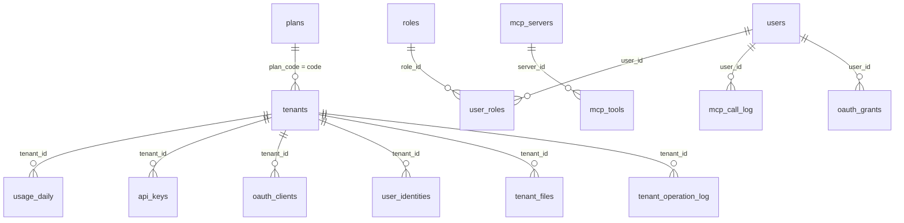

# 数据设计（库表与接口）

本文档描述当前数据库表结构与对外 HTTP 接口，是数据层的唯一索引。表结构以 `migrations/` 下的脚本为准，接口以各模块 `handler.go` 的注册为准；两者改动时必须同步本文档。

---

## 一、数据库分组

后端使用两个 PostgreSQL 库：**平台库**与**租户库**。同一个逻辑表只存在于其中一个库，不跨库 JOIN。

| 分组 | 承载内容 | 访问入口 | 隔离方式 |
| --- | --- | --- | --- |
| 平台库 | 租户、套餐、用量快照、平台账号、API Key、OAuth 客户端、审计、全局登录索引 | `tenancy.PlatformDB` | 不注入 `tenant_id`，按业务条件自行过滤 |
| 租户库 | 租户内用户、角色、配置、MCP 配置与调用日志、OAuth 授权、示例业务表 | `tenancy.DB` | 自动按 `tenant_id` 隔离 |

### 1.1 平台组表

| 表名 | 用途 |
| --- | --- |
| `tenants` | 租户主体与状态机、开通进度 |
| `plans` | 套餐与配额上限 |
| `usage_daily` | 按天落库的用量快照 |
| `api_keys` | 用户级 API Key（只存哈希） |
| `oauth_clients` | OAuth 2.1 动态注册的客户端 |
| `platform_users` | 平台管理员账号 |
| `user_identities` | 全局登录索引：登录标识 → 租户 + 用户 |
| `system_operation_log` | 平台操作审计 |

### 1.2 租户组表

| 表名 | 用途 |
| --- | --- |
| `users` | 租户用户 |
| `roles` | 租户角色与权限点 |
| `user_roles` | 用户与角色的绑定 |
| `tenant_configs` | 租户级 KV 配置 |
| `mcp_servers` | 上游 MCP 服务 |
| `mcp_tools` | 工具配置与所需权限点 |
| `mcp_call_log` | MCP 工具调用日志 |
| `oauth_grants` | 用户对 Agent 的授权 |
| `tenant_files` | 租户文件元数据（对象由 `pkg/storage` 保存） |
| `tenant_operation_log` | 租户内操作审计 |
| `widgets` | 示例业务表，用于验证隔离机制 |

### 1.3 隔离规则

1. 租户组表的查询、更新、删除由 `tenancy.DB` 自动追加 `tenant_id = ?`；插入时用当前 `Scope.TenantID` 覆盖。
2. 表存在但没有 `tenant_id` 列，访问直接返回 `ErrNotTenantTable`（fail closed）。
3. 更新与删除必须带条件（`Where` 或主键），否则返回 `ErrMissingCondition`；原生 SQL 只允许 `Scan`/`Count`。
4. 平台组表名单登记在 `pkg/tenancy/gorm.go` 的 `platformTables`，新增平台表时必须同步登记。
5. 所有主键使用 UUID v7，由应用生成。

---

## 二、平台组表结构

### 2.1 `tenants`

租户主体。状态机：`pending → active → suspended/expired → archived`；`suspended/expired → active`；任意非归档状态可转 `archived`。

| 列 | 类型 | 约束 / 默认 | 说明 |
| --- | --- | --- | --- |
| `id` | uuid | PK | 租户 ID |
| `code` | varchar(64) | NOT NULL，唯一 | 租户编码，`^[a-z0-9][a-z0-9-]{1,63}$` |
| `name` | varchar(128) | NOT NULL | 租户名称 |
| `status` | varchar(16) | NOT NULL，默认 `pending` | `pending` / `active` / `suspended` / `expired` / `archived` |
| `domain` | varchar(255) | 可空，非空唯一 | 独立域名 |
| `subdomain` | varchar(63) | 可空，非空唯一 | 子域名 |
| `plan_code` | varchar(64) | NOT NULL，默认 `free`，索引 | 当前套餐编码 |
| `expire_at` | timestamptz | 可空，索引 | 到期时间；读时判定过期 |
| `timezone` | varchar(64) | NOT NULL，默认 `UTC` | 时区 |
| `locale` | varchar(16) | NOT NULL，默认 `zh-CN` | 语言 |
| `contact_name` | varchar(64) | 可空 | 联系人 |
| `contact_phone` | varchar(32) | 可空 | 联系电话 |
| `contact_email` | varchar(128) | 可空 | 联系邮箱 |
| `admin_email` | varchar(255) | 可空 | 租户管理员邮箱 |
| `admin_phone` | varchar(32) | 可空，索引 | 租户管理员手机号（短信登录 / 验证码） |
| `provision_status` | varchar(16) | NOT NULL，默认 `pending` | `pending` / `running` / `succeeded` / `failed` |
| `provision_step` | varchar(64) | 可空 | 最近完成的步骤 |
| `provision_log` | jsonb | NOT NULL，默认 `[]` | 时间线，元素 `{step, ok, error, at}` |
| `deleted_at` | timestamptz | 可空 | 归档时间 |
| `created_at` | timestamptz | NOT NULL，默认 `now()` | |
| `updated_at` | timestamptz | NOT NULL，默认 `now()` | |

索引：`tenants_code_uniq(code)`、`tenants_domain_uniq(domain) WHERE domain IS NOT NULL`、`tenants_subdomain_uniq(subdomain) WHERE subdomain IS NOT NULL`、`tenants_status_idx(status)`、`tenants_plan_code_idx(plan_code)`、`tenants_expire_at_idx(expire_at)`、`tenants_admin_phone_idx(admin_phone)`。

写入约束：创建时 `provision_log` 必须显式写 `'[]'`，空串写入 jsonb 会报 `22P02`。

### 2.2 `plans`

套餐 = 一组配额上限。限额为 `0` 表示不限。

| 列 | 类型 | 约束 / 默认 | 说明 |
| --- | --- | --- | --- |
| `id` | uuid | PK | |
| `code` | varchar(64) | NOT NULL，唯一 | 创建后不可修改 |
| `name` | varchar(128) | NOT NULL | |
| `quota` | jsonb | NOT NULL，默认 `{}` | `max_users`、`storage_gb`、`api_qps`、`mcp_calls`、`mcp_tokens`、`mcp_sessions`、`features[]` |
| `enabled` | boolean | NOT NULL，默认 `true` | |
| `created_at` | timestamptz | NOT NULL，默认 `now()` | |
| `updated_at` | timestamptz | NOT NULL，默认 `now()` | |

内置数据：迁移脚本写入 `code = 'free'` 的默认套餐。

### 2.3 `usage_daily`

worker 把 Redis 中按天累计的用量落到此表。主键 `(tenant_id, metric, day)`。

| 列 | 类型 | 约束 / 默认 | 说明 |
| --- | --- | --- | --- |
| `tenant_id` | uuid | NOT NULL | 租户 ID |
| `metric` | varchar(32) | NOT NULL | `api_calls` / `mcp_calls` / `mcp_tokens` |
| `day` | date | NOT NULL | 用量日期 |
| `value` | bigint | NOT NULL | 当日累计值 |
| `updated_at` | timestamptz | NOT NULL，默认 `now()` | |

### 2.4 `api_keys`

用户级 API Key。明文只在创建响应出现一次，库内只存 SHA-256。

| 列 | 类型 | 约束 / 默认 | 说明 |
| --- | --- | --- | --- |
| `id` | uuid | PK | |
| `tenant_id` | uuid | NOT NULL | 所属租户 |
| `user_id` | uuid | NOT NULL | 所属用户，鉴权后写入 Scope |
| `name` | varchar(64) | NOT NULL | 用途备注 |
| `key_prefix` | varchar(16) | NOT NULL | 展示用前缀，形如 `sk_live_xxxxxx` |
| `key_hash` | varchar(64) | NOT NULL，唯一 | SHA-256 十六进制 |
| `revoked_at` | timestamptz | 可空 | 撤销时间 |
| `last_used_at` | timestamptz | 可空 | 最近使用时间 |
| `created_at` | timestamptz | NOT NULL，默认 `now()` | |

索引：`api_keys_hash_uniq(key_hash)`、`api_keys_tenant_user_idx(tenant_id, user_id)`。

明文格式：`sk_live_` + base64url 随机串。鉴权结果 `Identity{TenantID, UserID, ClientID: "apikey:{id}"}`。

### 2.5 `oauth_clients`

Agent 通过 RFC 7591 动态注册得到。

| 列 | 类型 | 约束 / 默认 | 说明 |
| --- | --- | --- | --- |
| `client_id` | varchar(64) | PK | `client_` + UUID |
| `tenant_id` | uuid | NOT NULL，索引 | 所属租户 |
| `client_name` | varchar(128) | NOT NULL | 客户端名称 |
| `redirect_uris` | jsonb | NOT NULL | 允许的回调地址数组 |
| `grant_types` | jsonb | NOT NULL，默认 `["authorization_code","refresh_token"]` | |
| `token_endpoint_auth_method` | varchar(32) | NOT NULL，默认 `none` | 公共客户端 |
| `revoked_at` | timestamptz | 可空 | |
| `created_at` | timestamptz | NOT NULL，默认 `now()` | |

索引：`oauth_clients_tenant_idx(tenant_id)`。

### 2.6 `platform_users`

| 列 | 类型 | 约束 / 默认 | 说明 |
| --- | --- | --- | --- |
| `id` | uuid | PK | |
| `email` | varchar(255) | NOT NULL，唯一 | 登录标识 |
| `password_hash` | varchar(255) | NOT NULL | bcrypt |
| `role` | varchar(32) | NOT NULL，默认 `owner` | `owner` / `viewer` |
| `status` | varchar(16) | NOT NULL，默认 `active` | 仅 `active` 可登录 |
| `refresh_jti` | varchar(64) | NOT NULL，默认 `''` | 当前 refresh 令牌 jti，单会话 |
| `created_at` | timestamptz | NOT NULL，默认 `now()` | |
| `updated_at` | timestamptz | NOT NULL，默认 `now()` | |

登录、刷新、登出、改密都会覆写 `refresh_jti`，旧 refresh 令牌立即失效。

### 2.7 `user_identities`

全局登录索引。只做定位，不存密码与资料；租户库 `users` 是唯一真相源。

| 列 | 类型 | 约束 / 默认 | 说明 |
| --- | --- | --- | --- |
| `identifier_type` | varchar(16) | PK 组成 | `email` / `phone` |
| `identifier` | varchar(255) | PK 组成 | 规范化后的标识 |
| `tenant_id` | uuid | NOT NULL | 定位到的租户 |
| `user_id` | uuid | NOT NULL | 定位到的用户 |
| `created_at` | timestamptz | NOT NULL，默认 `now()` | |
| `updated_at` | timestamptz | NOT NULL，默认 `now()` | |

主键 `(identifier_type, identifier)`；索引 `user_identities_tenant_user_idx(tenant_id, user_id)`。

写入点：开通租户、重试开通、租户内新建成员。删除点：归档租户、成员注销索引。对账命令：`go run ./cmd/migrate -command repair-identities`。

### 2.8 `system_operation_log`

| 列 | 类型 | 约束 / 默认 | 说明 |
| --- | --- | --- | --- |
| `id` | uuid | PK | |
| `category` | varchar(32) | NOT NULL | `tenant` / `plan` / `auth` / `security` / `config` / `system` |
| `action` | varchar(64) | NOT NULL | 代码常量，如 `tenant.create` |
| `level` | varchar(8) | NOT NULL，默认 `info` | `info` / `warn` |
| `result` | varchar(8) | NOT NULL，默认 `success` | `success` / `failed` |
| `actor_type` | varchar(16) | NOT NULL，默认 `admin` | `admin` / `system` |
| `actor_id` | uuid | 可空 | 操作人 ID |
| `actor_email` | varchar(255) | 可空 | 操作人邮箱 |
| `object_type` | varchar(32) | NOT NULL，默认 `''` | 对象类型 |
| `object_id` | varchar(64) | NOT NULL，默认 `''` | 对象 ID |
| `summary` | varchar(255) | NOT NULL，默认 `''` | 摘要 |
| `before_data` | jsonb | 可空 | 变更前快照 |
| `after_data` | jsonb | 可空 | 变更后快照 |
| `request_id` | varchar(64) | NOT NULL，默认 `''` | 请求链路 ID |
| `ip` | varchar(64) | NOT NULL，默认 `''` | 客户端 IP |
| `created_at` | timestamptz | NOT NULL，默认 `now()` | |

索引：`created_at DESC`、`(category, created_at DESC)`、`(object_type, object_id, created_at DESC)`、`(actor_id, created_at DESC)`。保留期由 `app.audit.retention_days` 控制，worker 每次 tick 清理。

---

## 三、租户组表结构

### 3.1 `users`

| 列 | 类型 | 约束 / 默认 | 说明 |
| --- | --- | --- | --- |
| `id` | uuid | PK | |
| `tenant_id` | uuid | NOT NULL，索引 | 隔离键 |
| `email` | varchar(255) | NOT NULL，默认 `''` | 可空；空串表示仅手机号注册。非空时租户内唯一，全局唯一由 `user_identities` 保证 |
| `phone` | varchar(32) | 可空 | 非空时租户内唯一 |
| `display_name` | varchar(64) | NOT NULL，默认 `''` | |
| `password_hash` | varchar(255) | NOT NULL | bcrypt |
| `status` | varchar(16) | NOT NULL，默认 `active` | `active` / `disabled` |
| `must_change_password` | boolean | NOT NULL，默认 `false` | 首次登录 / 重置密码后为 `true` |
| `token_version` | integer | NOT NULL，默认 `0` | 改密、重置密码时递增，旧令牌失效 |
| `refresh_jti` | varchar(64) | NOT NULL，默认 `''` | 当前 refresh 令牌 jti，单会话 |
| `created_at` | timestamptz | NOT NULL，默认 `now()` | |
| `updated_at` | timestamptz | NOT NULL，默认 `now()` | |

索引：`users_tenant_email_uniq(tenant_id, email) WHERE email <> ''`、`users_tenant_phone_uniq(tenant_id, phone) WHERE phone IS NOT NULL`、`users_tenant_id_idx(tenant_id)`。

### 3.2 `roles`

| 列 | 类型 | 约束 / 默认 | 说明 |
| --- | --- | --- | --- |
| `id` | uuid | PK | |
| `tenant_id` | uuid | NOT NULL，索引 | |
| `code` | varchar(64) | NOT NULL | `admin` / `member` |
| `name` | varchar(128) | NOT NULL | 显示名 |
| `permissions` | jsonb | NOT NULL，默认 `[]` | 权限点字符串数组，如 `["order:read"]` |
| `is_builtin` | boolean | NOT NULL，默认 `false` | 内置角色为 `true` |
| `created_at` | timestamptz | NOT NULL，默认 `now()` | |
| `updated_at` | timestamptz | NOT NULL，默认 `now()` | |

索引：`roles_tenant_code_uniq(tenant_id, code)`、`roles_tenant_id_idx(tenant_id)`。

内置角色以代码为准：`admin` 为 `["*:*"]`，`member` 为最小权限集；`cmd/migrate -sync-roles` 每版同步。

### 3.3 `user_roles`

| 列 | 类型 | 约束 / 默认 | 说明 |
| --- | --- | --- | --- |
| `tenant_id` | uuid | NOT NULL | |
| `user_id` | uuid | NOT NULL | |
| `role_id` | uuid | NOT NULL | |
| `created_at` | timestamptz | NOT NULL，默认 `now()` | |

索引：`user_roles_tenant_user_role_uniq(tenant_id, user_id, role_id)`、`user_roles_tenant_user_idx(tenant_id, user_id)`。

### 3.4 `tenant_configs`

| 列 | 类型 | 约束 / 默认 | 说明 |
| --- | --- | --- | --- |
| `tenant_id` | uuid | PK 组成 | |
| `namespace` | varchar(64) | PK 组成 | 配置分组 |
| `key` | varchar(128) | PK 组成 | 配置键 |
| `value` | text | NOT NULL | 配置值，字符串存储 |
| `updated_at` | timestamptz | NOT NULL，默认 `now()` | |

主键 `(tenant_id, namespace, key)`；索引 `tenant_configs_tenant_idx(tenant_id)`。

### 3.5 `mcp_servers`

| 列 | 类型 | 约束 / 默认 | 说明 |
| --- | --- | --- | --- |
| `id` | uuid | PK | |
| `tenant_id` | uuid | NOT NULL | |
| `name` | varchar(64) | NOT NULL | |
| `base_url` | varchar(512) | NOT NULL | 上游 MCP 地址，禁止内网 / 回环 |
| `credential` | text | 可空 | 上游凭据，`enc:v1:` 前缀为 AES-256-GCM 密文 |
| `enabled` | boolean | NOT NULL，默认 `true` | |
| `created_at` | timestamptz | NOT NULL，默认 `now()` | |
| `updated_at` | timestamptz | NOT NULL，默认 `now()` | |

索引：`mcp_servers_tenant_name_uniq(tenant_id, name)`。

### 3.6 `mcp_tools`

| 列 | 类型 | 约束 / 默认 | 说明 |
| --- | --- | --- | --- |
| `id` | uuid | PK | |
| `tenant_id` | uuid | NOT NULL | |
| `server_id` | uuid | NOT NULL | 所属上游服务 |
| `name` | varchar(128) | NOT NULL | 工具名 |
| `description` | text | NOT NULL，默认 `''` | |
| `input_schema` | jsonb | NOT NULL，默认 `{}` | JSON Schema |
| `required_perms` | jsonb | NOT NULL，默认 `[]` | 所需权限点数组，空表示登录即可用 |
| `enabled` | boolean | NOT NULL，默认 `true` | |
| `created_at` | timestamptz | NOT NULL，默认 `now()` | |
| `updated_at` | timestamptz | NOT NULL，默认 `now()` | |

索引：`mcp_tools_tenant_server_name_uniq(tenant_id, server_id, name)`。

`required_perms` 与 Web 控制台共用同一套权限点，保存时校验必须已登记。平台内置工具 `tenant.info` 不落表。

### 3.7 `mcp_call_log`

| 列 | 类型 | 约束 / 默认 | 说明 |
| --- | --- | --- | --- |
| `id` | uuid | PK | |
| `tenant_id` | uuid | NOT NULL | |
| `user_id` | uuid | NOT NULL | 调用者 |
| `client_id` | varchar(64) | NOT NULL | `apikey:{id}` 或 OAuth 客户端 ID |
| `tool_name` | varchar(128) | NOT NULL | |
| `status` | varchar(16) | NOT NULL | `succeeded` / `failed` |
| `duration_ms` | integer | NOT NULL，默认 `0` | |
| `error_code` | varchar(32) | 可空 | `quota` / `upstream` |
| `created_at` | timestamptz | NOT NULL，默认 `now()` | |

索引：`mcp_call_log_tenant_time_idx(tenant_id, created_at DESC)`。写入为异步，不阻塞响应。

### 3.8 `oauth_grants`

| 列 | 类型 | 约束 / 默认 | 说明 |
| --- | --- | --- | --- |
| `tenant_id` | uuid | NOT NULL | |
| `user_id` | uuid | NOT NULL | |
| `client_id` | varchar(64) | NOT NULL | |
| `scope` | varchar(64) | NOT NULL，默认 `mcp` | Agent 仅允许 `mcp` |
| `revoked_at` | timestamptz | 可空 | |
| `created_at` | timestamptz | NOT NULL，默认 `now()` | |
| `updated_at` | timestamptz | NOT NULL，默认 `now()` | |

索引：`oauth_grants_uniq(tenant_id, user_id, client_id)`。

### 3.9 `widgets`

示例业务表，用于隔离测试与接入参考。

| 列 | 类型 | 约束 / 默认 | 说明 |
| --- | --- | --- | --- |
| `id` | uuid | PK | |
| `tenant_id` | uuid | NOT NULL，索引 | |
| `name` | varchar(128) | NOT NULL | |
| `created_at` | timestamptz | NOT NULL，默认 `now()` | |
| `updated_at` | timestamptz | NOT NULL，默认 `now()` | |

索引：`widgets_tenant_id_idx(tenant_id)`、`widgets_tenant_id_id_uniq(tenant_id, id)`。

### 3.10 `tenant_files`

文件元数据；对象本体由 `pkg/storage` 的驱动保存（`local` / `cos` / `oss`）。

| 列 | 类型 | 约束 / 默认 | 说明 |
| --- | --- | --- | --- |
| `id` | uuid | PK | |
| `tenant_id` | uuid | NOT NULL，索引 | 隔离键 |
| `key` | varchar(512) | NOT NULL | 对象 key，`tenant/{tenant_id}/{biz}/{uuid}` |
| `biz` | varchar(64) | NOT NULL，默认 `''` | 业务分区，`^[a-z0-9][a-z0-9_-]{0,63}$` |
| `original_name` | varchar(255) | NOT NULL | 原始文件名（已清洗） |
| `content_type` | varchar(128) | NOT NULL，默认 `application/octet-stream` | |
| `size_bytes` | bigint | NOT NULL，默认 `0` | |
| `created_at` | timestamptz | NOT NULL，默认 `now()` | |

索引：`tenant_files_tenant_time_idx(tenant_id, created_at DESC)`、`tenant_files_tenant_biz_idx(tenant_id, biz, created_at DESC)`。

### 3.11 `tenant_operation_log`

租户内操作审计，按 `tenant_id` 隔离；平台侧审计仍写 `system_operation_log`。

| 列 | 类型 | 约束 / 默认 | 说明 |
| --- | --- | --- | --- |
| `id` | uuid | PK | |
| `tenant_id` | uuid | NOT NULL | 隔离键 |
| `actor_id` | uuid | 可空 | 操作人；系统任务为空 |
| `actor_email` | varchar(255) | NOT NULL，默认 `''` | 来自 JWT `email` claim |
| `category` | varchar(32) | NOT NULL | `security` / `config` / `file` / `oauth` |
| `action` | varchar(64) | NOT NULL | 代码常量，如 `user.create`、`file.delete` |
| `level` | varchar(8) | NOT NULL，默认 `info` | `info` / `warn` |
| `result` | varchar(8) | NOT NULL，默认 `success` | `success` / `failed` |
| `object_type` | varchar(32) | NOT NULL，默认 `''` | |
| `object_id` | varchar(64) | NOT NULL，默认 `''` | |
| `summary` | varchar(255) | NOT NULL，默认 `''` | |
| `before_data` | jsonb | 可空 | 变更前快照 |
| `after_data` | jsonb | 可空 | 变更后快照 |
| `request_id` | varchar(64) | NOT NULL，默认 `''` | |
| `ip` | varchar(64) | NOT NULL，默认 `''` | |
| `created_at` | timestamptz | NOT NULL，默认 `now()` | |

索引：`tenant_operation_log_time_idx(tenant_id, created_at DESC)`、`tenant_operation_log_category_idx(tenant_id, category, created_at DESC)`。

---

## 四、迁移与版本表

| 表 | 所属 | 说明 |
| --- | --- | --- |
| `schema_migrations_platform` | 平台库 | goose 版本记录 |
| `schema_migrations_tenant` | 租户库 | goose 版本记录 |
| `schema_migrations_checksum` | 两个库 | `pkg/migrate` 自维护，启动时 `Verify` 校验脚本未被篡改 |

迁移脚本位于 `migrations/platform/` 与 `migrations/tenant/`，通过 `migrations/embed.go` 打包。多进程迁移已用 `pg_advisory_lock(8127312)` 串行化。

---

## 五、实体关系



平台组与租户组之间没有外键，只在应用层通过 `tenant_id` 关联。

---

## 六、接口总则

### 6.1 响应外壳

除 MCP 端点与 OAuth `token` 端点（按 RFC 直接返回令牌对象）外，所有接口返回：

```json
{ "code": 0, "msg": "ok", "data": {}, "request_id": "..." }
```

成功 `code = 0`；失败时 HTTP 状态码由错误码映射，`data` 承载结构化上下文（如 `from` / `to`）。

### 6.2 鉴权与入口链

| 入口 | 路径前缀 | 令牌要求 |
| --- | --- | --- |
| 平台 | `/api/platform/v1` | JWT `aud = platform-api`，`actor_type = platform` |
| 租户 | `/api/tenant/v1` | JWT `aud = tenant-api`，`actor_type = tenant` |
| 全局登录 | `/api/tenant/v1/auth` | 免令牌，不需要租户上下文 |
| MCP | `/api/tenant/v1/mcp` | 用户级 API Key 或 JWT `aud = mcp` |
| 公开 | `/api/tenant/v1/oauth/*` | 免令牌，按 `X-Tenant-Id` 或子域名解析租户 |

请求头：

- `Authorization: Bearer <token>`：业务接口统一携带。
- `X-Tenant-Id: <uuid>`：请求体不含租户时用于定位；服务端以令牌内的 `tenant_id` 为准。
- `Mcp-Session-Id`：MCP 会话标识。
- `X-Request-Id`：可选，缺省由服务端生成并回写。

### 6.3 分页约定

带分页的列表统一返回 `{ "items": [], "total": 0, "page": 1, "size": 20 }`。`page` 默认 1，`size` 默认 20、最大 100。

### 6.4 令牌与 Cookie

| 令牌 | 有效期 | 存储 |
| --- | --- | --- |
| access token | 15 分钟 | 前端内存 |
| refresh token | 7 天 | httpOnly cookie |
| MCP 授权码 | 10 分钟 | Redis |
| MCP access token | 1 小时 | 客户端持有 |
| MCP refresh token | 7 天 | Redis + `oauth_grants` |

Cookie 名称与路径：平台 `saas_platform_refresh`（`/api/platform/v1/auth`），租户 `saas_tenant_refresh`（`/api/tenant/v1/auth`）。刷新采用轮换：每次刷新作废旧 `jti`，只保留最近一次。

---

## 七、平台侧接口

前缀 `/api/platform/v1`。平台角色只有 `owner`（全部权限）与 `viewer`（只读）。

### 7.1 会话与账号

| 方法 | 路径 | 权限 | 说明 |
| --- | --- | --- | --- |
| POST | `/auth/login` | 公开 | 邮箱 + 密码登录 |
| POST | `/auth/refresh` | 公开 | 读取 refresh cookie，轮换令牌 |
| POST | `/auth/logout` | 公开 | 作废 refresh，幂等 |
| GET | `/me` | 登录 | 返回账号、角色与权限点 |
| POST | `/auth/password` | 登录 | 修改自己的密码 |

`POST /auth/login`

```json
{ "email": "admin@example.com", "password": "********" }
```

返回 `{ "access_token": "...", "token_type": "Bearer", "expires_in": 900, "role": "owner" }`。refresh 令牌只走 httpOnly cookie，不进响应体。

`GET /me`

```json
{
  "user": { "id": "uuid", "email": "admin@example.com", "role": "owner" },
  "role": "owner",
  "permissions": ["tenant:read", "tenant:create", "plan:read", "audit:read", "stats:read"]
}
```

`POST /auth/password`：`{ "old_password": "...", "new_password": "..." }`，成功后清空 refresh cookie。

### 7.2 租户管理

| 方法 | 路径 | 权限 | 说明 |
| --- | --- | --- | --- |
| POST | `/tenants` | `tenant:create` | 开通租户，返回一次性初始密码 |
| GET | `/tenants` | `tenant:read` | 分页列表 |
| GET | `/tenants/summary` | `tenant:read` | 各状态计数 |
| GET | `/tenants/{id}` | `tenant:read` | 详情 |
| PATCH | `/tenants/{id}` | `tenant:update` | 改名 / 套餐 / 续费 / 联系方式 |
| PATCH | `/tenants/{id}/status` | `tenant:update` | 状态流转 |
| POST | `/tenants/{id}/retry` | `tenant:update` | 重跑开通流水线并重置管理员密码 |
| POST | `/tenants/{id}/admin-password` | `tenant:update` | 重置租户管理员密码 |
| GET | `/tenants/{id}/users` | `tenant:read` | 租户用户与角色 |
| GET | `/tenants/{id}/usage` | `tenant:read` | 套餐限额与用量 |
| DELETE | `/tenants/{id}` | `tenant:delete` | 归档租户 |

`POST /tenants` 入参：

| 字段 | 必填 | 说明 |
| --- | --- | --- |
| `code` | 是 | 租户编码，全局唯一 |
| `name` | 是 | 租户名称 |
| `admin_email` | 是 | 管理员邮箱，全局唯一 |
| `admin_display_name` | 否 | 默认「管理员」 |
| `admin_password` | 否 | 为空时生成一次性密码 |
| `plan_code` | 否 | 默认 `free` |
| `domain` / `subdomain` | 否 | 非空时全局唯一 |
| `timezone` / `locale` | 否 | 默认 `UTC` / `zh-CN` |
| `contact_name` / `contact_phone` / `contact_email` | 否 | 联系方式 |

返回 `201`：`{ "tenant": TenantOutput, "initial_password": "..." }`。

`GET /tenants` 查询参数：`page`、`size`、`status`、`keyword`（编码 / 名称模糊）、`plan_code`、`expire_before`（RFC3339）。

`GET /tenants/summary` 返回：`{ total, pending, active, suspended, expired, archived }`。

`PATCH /tenants/{id}` 入参（字段缺省表示不改）：`name`、`plan_code`、`expire_at`、`timezone`、`locale`、`contact_name`、`contact_phone`、`contact_email`。`expired` 租户续费到未来时间会自动回到 `active`。

`PATCH /tenants/{id}/status` 入参 `{ "status": "suspended" }`，按状态机白名单校验。

`GET /tenants/{id}/users` 返回 `{ "items": [{ id, email, display_name, status, roles, must_change_password, created_at }] }`。

`GET /tenants/{id}/usage` 返回：

```json
{
  "plan_code": "free",
  "max_users": 10,
  "mcp_calls_cap": 100000,
  "mcp_tokens_cap": 5000000,
  "api_qps": 20,
  "usage": { "users": 3, "mcp_calls": 1200, "api_calls": 800, "mcp_tokens": 45000 },
  "series": [{ "date": "11-01", "value": 12 }]
}
```

用量统计窗口：`usage_daily` 近 30 天；`series` 为近 7 天 MCP 调用，缺失日期补 0；`users` 为租户库实时计数。

`TenantOutput` 字段：`id`、`code`、`name`、`domain`、`subdomain`、`status`、`plan_code`、`expire_at`、`timezone`、`locale`、`contact_name`、`contact_phone`、`contact_email`、`admin_email`、`provision_status`、`provision_step`、`provision_log[]`、`created_at`、`updated_at`。

### 7.3 套餐管理

| 方法 | 路径 | 权限 | 说明 |
| --- | --- | --- | --- |
| GET | `/plans` | `plan:read` | 返回数组 |
| POST | `/plans` | `plan:update` | 新建 |
| PATCH | `/plans/{id}` | `plan:update` | 改名称 / 配额 / 启停 |

`POST /plans`：`{ "code": "pro", "name": "Pro", "quota": { ... }, "enabled": true }`。
`PATCH /plans/{id}`：`{ "name": "...", "quota": { ... }, "enabled": false }`，`code` 不可改。

`PlanOutput`：`id`、`code`、`name`、`quota`、`enabled`、`tenant_count`、`created_at`、`updated_at`。

### 7.4 审计日志

| 方法 | 路径 | 权限 | 说明 |
| --- | --- | --- | --- |
| GET | `/audit-logs` | `audit:read` | 分页查询 |

查询参数：`category`、`action`、`level`、`actor`（邮箱或用户 ID）、`object_id`、`from`、`to`（RFC3339）、`page`、`size`。

返回行字段：`id`、`category`、`action`、`level`、`result`、`actor_type`、`actor_email`、`object_type`、`object_id`、`summary`、`before`、`after`、`request_id`、`ip`、`created_at`。

### 7.5 统计

| 方法 | 路径 | 权限 | 说明 |
| --- | --- | --- | --- |
| GET | `/stats/overview` | `stats:read` | 总览数字 |
| GET | `/stats/usage-top` | `stats:read` | 用量排行 |

`GET /stats/overview` 返回：

```json
{
  "tenant_total": 30,
  "tenant_active": 25,
  "new_this_week": 3,
  "expiring_soon": 2,
  "provision_failed": 1,
  "mcp_calls_total": 120000,
  "new_series": [{ "date": "11-01", "value": 1 }]
}
```

`GET /stats/usage-top?metric=mcp_calls&limit=5`：`metric` 默认 `mcp_calls`，`limit` 默认 5、最大 20；返回 `[{ tenant_id, name, value }]`。

---

## 八、租户侧接口

前缀 `/api/tenant/v1`。权限点为 `{对象}:{动作}`，`read` 同时覆盖列表与详情。

### 8.1 会话与资料

| 方法 | 路径 | 权限 | 说明 |
| --- | --- | --- | --- |
| POST | `/auth/login` | 公开 | 全局登录，只收邮箱 + 密码 |
| POST | `/auth/refresh` | 公开 | 轮换 refresh cookie |
| POST | `/auth/logout` | 公开 | 幂等登出 |
| POST | `/auth/otp/send` | 公开 | 发送短信验证码（`signup` / `login` / `reset`） |
| POST | `/auth/password/reset` | 公开 | 手机号 + 验证码重置密码 |
| GET | `/me` | 登录 | 用户、租户、权限点 |
| POST | `/auth/password` | 登录 | 修改自己的密码 |

`POST /auth/login` 返回 `{ access_token, token_type, expires_in, must_change_password }`，refresh 令牌写入 cookie。支持邮箱 + 密码、手机号 + 密码、手机号 + 验证码三种方式；登录先用 `user_identities` 定位租户，再在租户作用域内校验密码；租户不可用（停用 / 过期 / 待开通）直接拒绝。

`GET /me` 返回：

```json
{
  "user": { "id": "uuid", "email": "...", "display_name": "...", "roles": ["admin"] },
  "tenant": { "id": "uuid", "name": "...", "subdomain": "...", "plan_code": "free" },
  "permissions": ["*:*"]
}
```

### 8.2 API Key（用户级）

| 方法 | 路径 | 权限 | 说明 |
| --- | --- | --- | --- |
| GET | `/api-keys` | `apikey:read` | 当前用户的 Key 列表 |
| POST | `/api-keys` | `apikey:create` | 创建，明文只返回一次 |
| DELETE | `/api-keys/{id}` | `apikey:revoke` | 撤销 |

`POST /api-keys` 入参 `{ "name": "CI" }`，返回 `{ "key": { id, name, key_prefix, revoked_at, last_used_at, created_at }, "plain": "sk_live_..." }`。

### 8.3 成员与角色

| 方法 | 路径 | 权限 | 说明 |
| --- | --- | --- | --- |
| GET | `/users` | `user:read` | 分页列表 |
| POST | `/users` | `user:create` | 新建成员 |
| PATCH | `/users/{id}` | `user:update` | 改姓名 / 状态 |
| POST | `/users/{id}/password` | `user:update` | 重置密码 |
| PATCH | `/users/{id}/roles` | `user:update` | 替换角色绑定 |
| GET | `/roles` | `role:read` | 内置角色（只读） |

`GET /users` 查询参数：`page`、`size`、`status`、`keyword`（邮箱 / 姓名）。
`POST /users` 入参：`{ "email", "phone", "display_name", "password", "role" }`；`email` 与 `phone` 至少一个，`password` 为空时生成一次性密码，`role` 默认 `member`，返回 `{ user, initial_password }`。
`PATCH /users/{id}`：`{ "display_name"?, "status"? }`，状态只允许 `active` / `disabled`。
`PATCH /users/{id}/roles`：`{ "codes": ["admin"] }`，至少一个角色。

约束：邮箱全局唯一；停用成员或移除 `admin` 角色前，必须保证仍有至少一个 `active` 管理员。

`UserOutput`：`id`、`email`、`display_name`、`status`、`roles`、`must_change_password`、`created_at`。
`RoleOutput`：`id`、`code`、`name`、`permissions[]`。

### 8.4 租户配置

| 方法 | 路径 | 权限 | 说明 |
| --- | --- | --- | --- |
| GET | `/configs?namespace=general` | `tenantconf:read` | 列出命名空间下的配置 |
| GET | `/configs/{namespace}/{key}` | `tenantconf:read` | 读取单个配置 |
| PUT | `/configs/{namespace}/{key}` | `tenantconf:update` | 写入 / 更新 |
| DELETE | `/configs/{namespace}/{key}` | `tenantconf:update` | 删除 |

`PUT` 入参 `{ "value": "..." }`。列表返回 `{ "items": [{ namespace, key, value, updated_at }] }`。

### 8.5 MCP 配置

| 方法 | 路径 | 权限 | 说明 |
| --- | --- | --- | --- |
| GET | `/mcp/servers` | `mcp:read` | 上游服务列表 |
| POST | `/mcp/servers` | `mcp:update` | 新建上游服务 |
| PATCH | `/mcp/servers/{id}` | `mcp:update` | 修改上游服务 |
| DELETE | `/mcp/servers/{id}` | `mcp:update` | 删除服务及其工具 |
| GET | `/mcp/tools?server_id=` | `mcp:read` | 工具列表 |
| PATCH | `/mcp/tools/{id}` | `mcp:update` | 改启用状态 / 所需权限点 |
| GET | `/mcp/calls` | `mcp:read` | 调用日志 |

`POST /mcp/servers`：`{ "name", "base_url", "credential", "enabled" }`；`base_url` 必须是 http/https，且不能指向内网、回环或链路本地地址；`credential` 加密后入库，永不回显。
`PATCH /mcp/servers/{id}`：同上字段均可选，`credential` 传空串表示清除。
`PATCH /mcp/tools/{id}`：`{ "enabled": true, "required_perms": ["order:read"] }`，权限点必须已登记。
`GET /mcp/calls` 查询参数：`status`、`tool`、`page`、`size`。

`ServerOutput`：`id`、`name`、`base_url`、`has_credential`、`enabled`、`tool_count`、`created_at`、`updated_at`。
`ToolOutput`：`id`、`server_id`、`name`、`description`、`input_schema`、`required_perms[]`、`enabled`、`updated_at`。
`CallOutput`：`id`、`user_id`、`client_id`、`tool_name`、`status`、`duration_ms`、`error_code`、`created_at`。

### 8.6 OAuth 授权管理

| 方法 | 路径 | 权限 | 说明 |
| --- | --- | --- | --- |
| GET | `/oauth/grants?include_revoked=1` | `oauth.grant:read` | 授权列表 |
| DELETE | `/oauth/grants/{client_id}` | `oauth.grant:revoke` | 撤销授权 |

`Output`：`client_id`、`client_name`、`scope`、`revoked_at`、`created_at`、`updated_at`。

### 8.7 租户统计

| 方法 | 路径 | 权限 | 说明 |
| --- | --- | --- | --- |
| GET | `/stats/overview` | `stats:read` | 成员、套餐、近 30 天用量、近 7 天趋势 |

返回：

```json
{
  "members": { "total": 5, "active": 4 },
  "plan": { "code": "free", "name": "Free", "max_users": 10, "quota": {} },
  "usage": {
    "calls_30d": 1200,
    "failed_30d": 12,
    "avg_duration_ms_30d": 85,
    "active_api_keys": 2,
    "metric_totals": { "mcp_calls": 1200, "api_calls": 800, "mcp_tokens": 45000 }
  },
  "call_series": [{ "date": "11-01", "value": 120 }]
}
```

### 8.8 文件

| 方法 | 路径 | 权限 | 说明 |
| --- | --- | --- | --- |
| GET | `/files?biz=` | `file:read` | 文件列表（最多 200 条） |
| POST | `/files` | `file:create` | 上传（multipart，字段 `file`、`biz`） |
| DELETE | `/files/{id}` | `file:delete` | 删除元数据并异步删除对象 |
| GET | `/files/{id}/url?ttl=` | `file:read` | 临时下载地址 |
| GET | `/api/files/download?key=&expires=&sig=` | 公开 | 本地驱动的签名下载 |

上传受 `storage.max_upload_mb` 与套餐 `storage_gb` 限制；对象 key 由服务端拼接。删除先删元数据，再投递 `file.delete`，投递失败时同步删除对象。

`FileOutput`：`id`、`key`、`biz`、`original_name`、`content_type`、`size_bytes`、`created_at`。

### 8.9 租户审计

| 方法 | 路径 | 权限 | 说明 |
| --- | --- | --- | --- |
| GET | `/audit-logs` | `audit:read` | 租户内操作审计分页查询 |

查询参数：`category`、`action`、`level`、`actor`（邮箱或用户 ID）、`from` / `to`（RFC3339）、`page`、`size`。仅 `admin` 拥有 `audit:read`。

已埋点：成员创建 / 修改 / 重置密码 / 变更角色、API Key 创建 / 撤销、MCP 服务与工具配置、文件上传 / 删除、OAuth 授权撤销。

---

## 九、MCP 接口

单端点：`POST /api/tenant/v1/mcp`，Streamable HTTP，JSON-RPC 2.0。

鉴权：`Authorization: Bearer <API Key 或 aud=mcp 的 access token>`。Web 的 `tenant-api` 令牌在此入口返回 401。

| 请求头 | 说明 |
| --- | --- |
| `Accept: application/json` | 普通 JSON 响应 |
| `Accept: text/event-stream` | 按 SSE 单帧返回 |
| `Mcp-Session-Id` | `initialize` 之后所有请求必带 |

### 9.1 JSON-RPC 方法

| 方法 | 说明 |
| --- | --- |
| `initialize` | 创建会话，响应头返回 `Mcp-Session-Id`，下发协议版本与 `serverInfo` |
| `ping` | 返回空结果 |
| `tools/list` | 返回当前用户有权使用的工具 |
| `tools/call` | 执行工具 |

`tools/call` 参数 `{ "name": "...", "arguments": {} }`，成功结果为 `{"content": [{"type": "text", "text": "<JSON 字符串>"}]}`。会话绑定 `(tenant, user, client)`，不匹配返回 404。

### 9.2 错误码

| code | 含义 |
| --- | --- |
| `-32600` | 请求格式错误 |
| `-32601` | 方法不存在 |
| `-32602` | 参数错误 |
| `-32000` | 上游服务错误 |
| `-32001` | 配额或限流超限 |
| `-32003` | 无权限 |

平台错误码放在 `error.data.code`。

### 9.3 工具来源

1. 内置工具：`tenant.info`，返回 `{ tenant_id, user_id, client_id }`。
2. 租户工具：`mcp_tools` 中 `enabled = true` 的记录；调用时按 `name` 找到服务，转发到 `mcp_servers.base_url`，凭据解密后作为 Bearer。

工具可见性与可调用性使用同一组 `required_perms` 求值，走同一个 `pkg/authz` 与角色缓存。

---

## 十、OAuth 2.1 接口

用于 Agent 接入（授权码 + PKCE，`scope = mcp`）。

| 方法 | 路径 | 鉴权 | 说明 |
| --- | --- | --- | --- |
| POST | `/api/tenant/v1/oauth/register` | 公开 | 动态注册客户端 |
| GET | `/api/tenant/v1/oauth/authorize` | 租户用户令牌 | 生成授权码并 302 回跳 |
| POST | `/api/tenant/v1/oauth/token` | 公开 | 授权码换令牌 / 刷新令牌 |
| POST | `/api/tenant/v1/oauth/revoke` | 公开 | 撤销 refresh 令牌 |
| GET | `/.well-known/oauth-authorization-server` | 公开 | RFC 8414 元数据 |
| GET | `/.well-known/oauth-protected-resource` | 公开 | RFC 9728 元数据 |

`register` 入参 `{ "client_name": "...", "redirect_uris": ["https://..."] }`，返回 `201 { client_id, client_name, redirect_uris }`。回调地址只允许 HTTPS 与本地回环。

`authorize` 查询参数：`client_id`、`redirect_uri`、`state`（必填）、`code_challenge`、`code_challenge_method`（仅 `S256`）、`scope`（默认 `mcp`）。

`token` 表单参数：`grant_type`、`code`、`redirect_uri`、`client_id`、`code_verifier`、`refresh_token`；也可用 JSON 并附 `tenant_id`。返回 `{ access_token, token_type, expires_in, refresh_token, scope }`。

`revoke` 表单入参 `token`，并通过 `X-Tenant-Id` 指定租户。刷新令牌每次使用后轮换，旧令牌立即失效。

---

## 十一、公共接口

| 方法 | 路径 | 说明 |
| --- | --- | --- |
| GET | `/health` | 存活探针 |
| GET | `/readyz` | 就绪探针，检查数据库与 Redis |
| GET | `/metrics` | Prometheus 指标（`app.metrics.enabled` 开启时） |
| GET | `/openapi.yaml` | OpenAPI 3.1 规范（`docs.enabled` 开启时） |
| GET | `/docs` | Swagger UI（`docs.enabled` 开启时） |
| GET | `/`、`/pricing`、`/signup`、`/signup/done`、`/login`、`/terms`、`/privacy` | 营销门户（`portal.enabled` 开启时） |
| POST | `/signup`、`/signup/otp` | 自助注册与注册验证码（同源校验 + IP 限流 + 蜜罐） |

---

## 十二、错误码

| 码 | 名称 | HTTP |
| --- | --- | --- |
| 1000 | 参数不合法 | 400 |
| 1001 | 资源不存在 | 404 |
| 1002 | 冲突 | 409 |
| 1003 | 内部错误 | 500 |
| 1004 | 服务不可用 | 503 |
| 10001 | 租户不存在 | 404 |
| 10002 | 租户未就绪 | 403 |
| 10003 | 租户已停用 | 403 |
| 10004 | 租户已到期 | 403 |
| 10005 | 租户开通失败 | 409 |
| 20001 | 未认证 | 401 |
| 20002 | 令牌无效 | 401 |
| 20003 | 令牌过期 | 401 |
| 20004 | 禁止访问 | 403 |
| 20005 | 无权限 | 403 |
| 20006 | 身份不匹配 | 403 |
| 30001 | 配额超限 | 429 |
| 30002 | 套餐不存在 | 404 |
| 40001 | 存储不可用 | 503 |
| 40002 | 文件不存在 | 404 |

---

## 十三、数据流

### 13.1 开通租户

1. 校验邮箱全局唯一，写 `tenants`（`pending`，`provision_log = []`），提交。
2. 租户库同一事务内：写内置角色、管理员用户、角色绑定。
3. 写 `user_identities`，记录 `email → (tenant_id, user_id)`。
4. 平台库置 `active` / `provision_status = succeeded` / `provision_step = done`。
5. 写审计 `tenant.create`。任一步失败置 `provision_status = failed`，可通过重试接口续跑。

### 13.2 用量

1. 请求进入租户链时按套餐缓存校验 QPS，并累加 `api_calls`。
2. MCP 调用按 `mcp_calls`、`mcp_tokens` 计数，Redis hash `quota:usage`，键为 `tenant|metric|day`。
3. worker 按周期把 Redis 用量落到 `usage_daily`，并清理过期键。

### 13.3 审计

业务写入点直接调用 `audit.Service.Record`，操作人从 `tenancy.Scope` 推导；登录失败等无 Scope 场景显式指定 `actor_type` / `actor_id` / `actor_email`。`request_id` 与 `ip` 由公共中间件写入。worker 按 `audit.retention_days` 清理过期记录。

### 13.4 到期与归档

- 读时判定：`status = active` 且 `expire_at < now()` 视为 `expired`，不写库；租户链与 MCP 链在鉴权后执行该判定。
- worker 每日把 `active` 且已过期的租户落库为 `expired`。
- 归档：写 `deleted_at`，删除 `user_identities` 中的租户索引，清理租户库框架表数据。

### 13.5 登录索引

- 平台账号登录直接查 `platform_users`。
- 租户用户登录先查 `user_identities` 定位租户，再在租户作用域内校验密码与状态。
- 新建成员前先查索引保证邮箱全局唯一；索引写入失败时删除刚创建的用户。
- 对账命令 `go run ./cmd/migrate -command repair-identities` 按租户库 `users` 重建索引。
